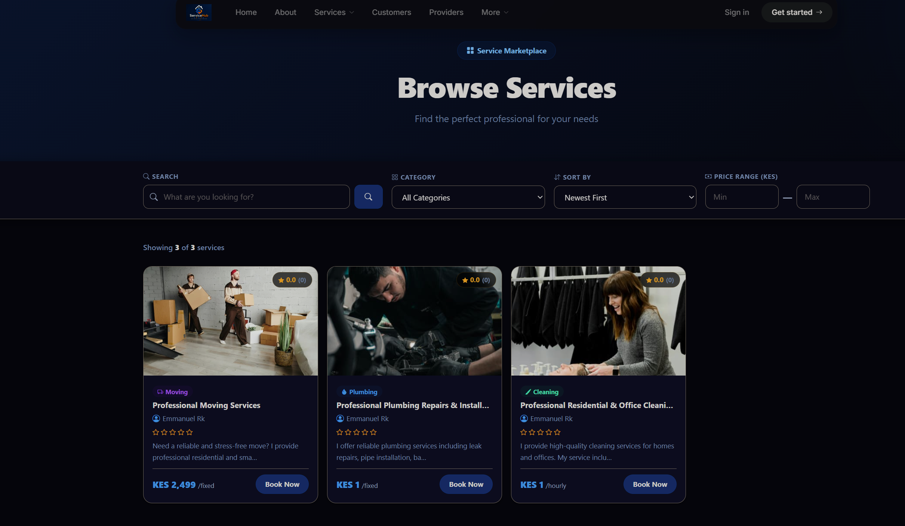
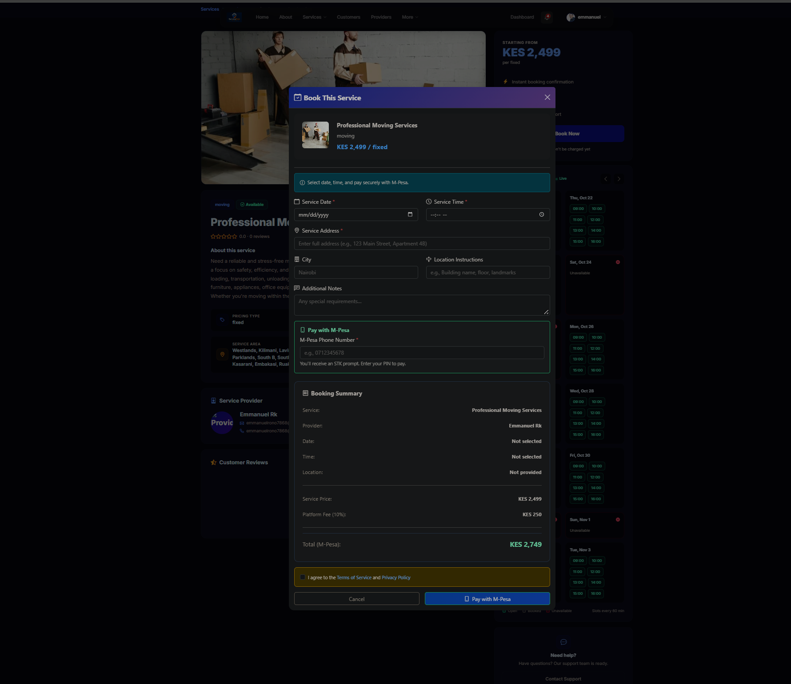
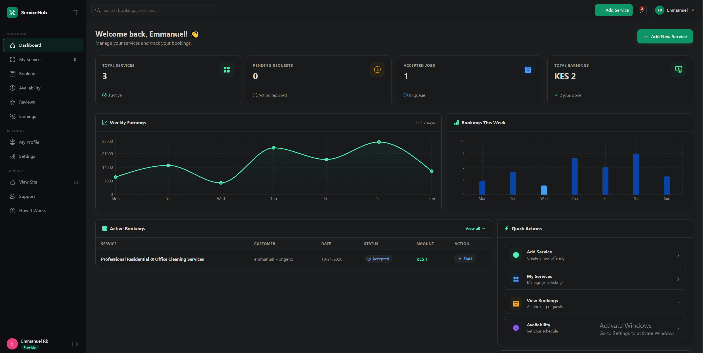

# ServiceHub

**A local services booking platform that connects customers with trusted service providers: plumbers, electricians, cleaners, tutors, mechanics, and more.**

**Live demo:** https://servicehub-cppv.onrender.com

> The app is hosted on a free tier, so the first load after inactivity can take 30-60 seconds while the server wakes up.


---

## The Problem

Finding reliable local service providers is hard, especially in emerging markets like Kenya:

- No central place to discover trusted providers
- No transparent pricing
- Difficult to verify a provider's experience and reliability
- No standard booking or scheduling system
- No reviews or accountability
- Cash-only transactions with no records

## The Solution

ServiceHub gives customers one place to find verified providers, see clear pricing, book a time slot, pay with M-Pesa, track the job, and leave a review. Providers get a professional profile, a booking dashboard, and instant alerts for new requests.

---

## Features

### Customers
- Sign up with email or **Google Sign-In**
- Browse, search, and filter services by category, location, and keyword
- View provider profiles, pricing, portfolio images, and reviews
- Book a service by choosing a date and time and adding instructions
- **Pay with M-Pesa** through an STK Push prompt on their phone
- Track booking status: pending, accepted, in progress, completed, cancelled, rejected
- Reschedule or cancel a booking
- **Rate and review** completed jobs (1-5 stars with written feedback)
- Dashboard with upcoming and past bookings

### Service Providers
- Create and manage a service profile with pricing and portfolio images
- Manage availability
- Accept or reject booking requests, with an optional note
- Update job status through the lifecycle (accept, start, complete)
- Receive customer reviews and ratings on their profile
- Earnings and booking statistics dashboard

### Admins
- Approve or reject new provider registrations
- Manage users and platform activity

### Platform
- Email verification, Google Sign-In, and secure login (JWT, role-based access control)
- **M-Pesa payments** via the Safaricom Daraja API (STK Push)
- **Double-booking prevention** for provider time slots
- **Real-time updates** with Socket.IO: booking status changes and provider availability refresh live
- **Multi-channel notifications** for every booking event:
  - In-app notifications
  - Real-time socket events
  - Push notifications (Firebase Cloud Messaging)
  - Email (Brevo API)
- Per-user notification preferences
- Image uploads with Multer and Cloudinary

---

## Booking Lifecycle

```
pending --> accepted --> in-progress --> completed --> review
   |           |
   +--> rejected   +--> cancelled (customer or provider, before completion)
```

Every transition notifies the other party in real time and by email.

---

## Tech Stack

| Layer | Technology |
|-------|-----------|
| Frontend | React, React Router, [Redux Toolkit / Context], [Tailwind CSS / MUI], Axios |
| Backend | Node.js, Express |
| Database | MongoDB with Mongoose |
| Auth | JWT, bcrypt, Google Sign-In (OAuth) |
| Payments | M-Pesa (Safaricom Daraja API, STK Push) |
| Real-time | Socket.IO |
| Notifications | Firebase Cloud Messaging (push), Brevo (email) |
| Media | Multer, Cloudinary |
| Hosting | Render (API and frontend), MongoDB Atlas |

---

## Architecture Notes

**Notification pipeline.** A single `notify()` helper handles every booking event. It saves an in-app notification, emits it over Socket.IO, sends an email, and delivers a push notification, while respecting each user's notification preferences. Controllers only call `notify()`, so adding a new event type needs no extra delivery code.

**M-Pesa STK Push.** The backend requests an STK Push from Safaricom's Daraja API, which shows a payment prompt on the customer's phone. The customer confirms with their M-Pesa PIN, and Safaricom reports the result to a callback endpoint on the API.

**Email delivery on a free host.** Render's free tier blocks outbound SMTP ports (25, 465, 587), so SMTP-based libraries like Nodemailer time out in production even though they work locally. ServiceHub sends transactional email through Brevo's HTTPS API instead, which needs no SMTP ports and has a free tier. Email failures are caught and logged, so a mail problem can never break a booking.

**Double-booking prevention.** Before a booking is created or rescheduled, the API checks for an active booking (pending, accepted, confirmed, or in progress) for the same provider, date, and time.

---

## Getting Started

### Prerequisites
- Node.js 18+
- A MongoDB database (local or MongoDB Atlas)
- Accounts for Cloudinary, Brevo, Google Cloud (OAuth), and Safaricom Daraja (sandbox)

### 1. Clone

```bash
git clone [YOUR_REPO_URL]
cd servicehub
```

### 2. Backend

```bash
cd backend
npm install
cp .env.example .env   # then fill in your values
npm run dev
```

**Backend environment variables**

```env
PORT=5000
NODE_ENV=development
MONGO_URI=your_mongodb_connection_string
JWT_SECRET=your_long_random_secret
CLIENT_URL=http://localhost:3000

# Email (Brevo API)
BREVO_API_KEY=your_brevo_api_key
BREVO_SENDER_EMAIL=your_verified_sender_email

# Images
CLOUDINARY_CLOUD_NAME=
CLOUDINARY_API_KEY=
CLOUDINARY_API_SECRET=

# Google Sign-In
GOOGLE_CLIENT_ID=

# M-Pesa (Daraja)
MPESA_CONSUMER_KEY=
MPESA_CONSUMER_SECRET=
MPESA_SHORTCODE=
MPESA_PASSKEY=
MPESA_CALLBACK_URL=https://your-api-domain/api/[payments-callback-route]

# Push notifications (optional)
[FIREBASE_VARIABLES]
```

> The Brevo sender email must be verified in your Brevo account. Use an **API key**, not an SMTP key.
> The M-Pesa callback URL must be a public HTTPS address, so use your deployed API URL (or a tunnel such as ngrok when testing locally).

### 3. Frontend

```bash
cd frontend
npm install
cp .env.example .env
npm start
```

```env
REACT_APP_API_URL=http://localhost:5000/api
REACT_APP_GOOGLE_CLIENT_ID=
```

---

## API Overview

Base path: `/api`. Protected routes require authentication.

### Bookings

| Method | Endpoint | Description | Access |
|--------|----------|-------------|--------|
| POST | `/bookings` | Create a booking | Customer |
| GET | `/bookings` | List my bookings (filter by `status`, paginated) | Customer, Provider, Admin |
| GET | `/bookings/:id` | Get one booking | Customer or Provider of that booking, Admin |
| PUT | `/bookings/:id` | Reschedule or edit notes | Customer |
| PUT | `/bookings/:id/accept` | Accept a request | Provider |
| PUT | `/bookings/:id/reject` | Reject a request | Provider |
| PUT | `/bookings/:id/start` | Start the service | Provider |
| PUT | `/bookings/:id/complete` | Complete the service | Provider |
| PUT | `/bookings/:id/cancel` | Cancel a booking | Customer or Provider |
| DELETE | `/bookings/:id` | Delete a pending or accepted booking | Customer |
| GET | `/bookings/stats/dashboard` | Booking statistics | Any logged-in user |

[ADD: Auth, Services, Reviews, Payments, and Admin endpoints]

---

## Project Structure

```
backend/
  src/
    controllers/   # Route handlers (bookings, services, auth, ...)
    models/        # Mongoose schemas
    routes/        # Express routers
    socket/        # Socket.IO setup
    utils/         # notify, sendEmail, sendPush
frontend/
  src/
    components/
    pages/
    ...
```

---

## Demo Accounts

| Role | Email | Password |
|------|-------|----------|
| Customer | [demo-customer@example.com] | [password] |
| Provider | [demo-provider@example.com] | [password] |
| Admin | [demo-admin@example.com] | [password] |

> Notification emails are sent to the address on each account. Check your spam folder when testing.
> [If payments run in the Daraja sandbox, say so here: "Payments use the M-Pesa sandbox, so no real money is charged."]

---

## Screenshots

| Home | Service details |
|------|-----------------|
|  |  |

| Booking flow | Provider dashboard |
|--------------|--------------------|
|  |  |

---

## Roadmap

- Card payments (Stripe) and escrow with automatic provider payouts
- In-app chat between customers and providers
- Google Maps integration for service areas
- SMS notifications
- Swahili language support
- Automated tests and CI/CD

---

## What I Learned

- Designing a multi-role system (customer, provider, admin) with role-based authorization
- Modeling a booking state machine and preventing double-booking
- Integrating M-Pesa STK Push (Daraja) with asynchronous callbacks
- Adding Google OAuth alongside email and password authentication
- Building one notification pipeline that fans out to in-app, real-time, push, and email channels
- Debugging a production-only failure: SMTP worked locally but was blocked on the host, which led to moving to an HTTPS email API
- Deploying a full MERN application with environment-based configuration

---

## Author

**Emmanuel Kipngeno**

[Portfolio](https://kipngeno-creative-hub.onrender.com/) | [LinkedIn](https://linkedin.com/in/emmanuelkipngeno) | [GitHub](https://github.com/kkmanuu) | [Email](mailto:kipngenoemmanuel479@gmail.com)

## License

Copyright (c) 2026 Emmanuel Kipngeno. All rights reserved. This source code is proprietary and may not be copied, modified, or distributed without written permission.